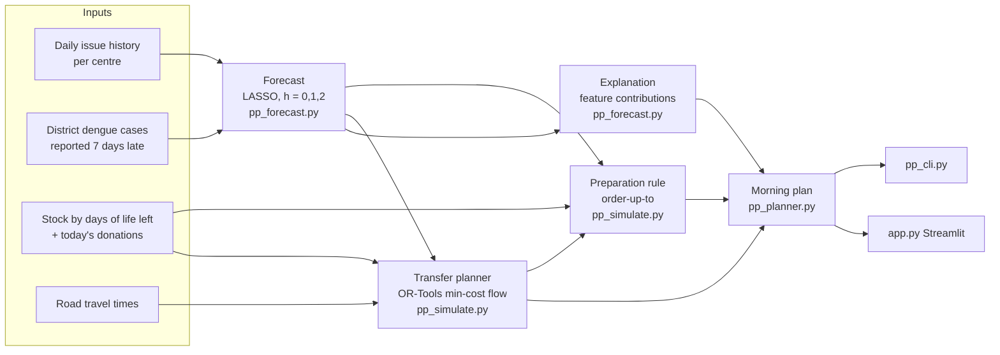

# Architecture

PlateletPlan is a small Python package with two front ends, a command line and a Streamlit app. There is no database and no server. Everything runs from CSVs and in memory.



## Components

| Module | Responsibility | Key choices |
|---|---|---|
| `pp_config.py` | All parameters and assumptions | One place to change anything, with each assumption labelled |
| `pp_data.py` | Seeded synthetic data generator, travel times | See DATA.md; a `shock_from_year` option creates an unseen outbreak |
| `pp_forecast.py` | LASSO forecaster per centre and horizon; 7-day average baseline; explanations; WAPE | LASSO: matched an LSTM in the Aachen study, explainable, works with little data. Features: lags 1–7, 7- and 28-day means, target weekday, reported dengue cases and their 4-week change. `LassoCV` with `TimeSeriesSplit`, so it never trains on the future |
| `pp_simulate.py` | Day-by-day inventory model; preparation policies; transfers | FIFO issuing; units expire at the end of day 5; preparation is capped by donations |
| `pp_pipeline.py` | Fit, calibrate, tune and test; writes the result CSVs | Time split: fit 2021–23, tune 2024, test 2025 |
| `pp_planner.py` | Morning plan for one centre and date; "bring your own register" back-test | Shared by the CLI and the app |
| `app.py` | Streamlit interface: Today's plan, Evaluation, Use your own register, Data & limits | No custom front-end code |

## The daily decision

For centre *c* on day *t*, with forecasts *f₀, f₁, f₂*, forecast error *σ*, horizon *H* and safety factor *z*:

```
target  = f₀ + … + f_(H-1)  +  z · σ · √H
prepare = clamp( ceil(target − usable stock on hand), 0, today's donations )
```

*H* and *z* are tuned on 2024 by grid search (H ∈ {1, 2, 3}, z ∈ {0, 0.25, …, 3}), minimising **expired units + 10 × short units**. Every policy, including the baseline, is tuned the same way, so the comparison is fair.

## Transfers (network policy)

Each morning, before preparation:

- **Surplus at centre i** = units expiring tonight beyond today's forecast, plus units expiring tomorrow beyond the forecast demand they could still meet.
- **Deficit at centre j** = (f₀ + f₁ + z·σ·√2) − stock.
- A min-cost flow (OR-Tools `SimpleMinCostFlow`) moves surplus to deficit. Arc cost = travel minutes, and only pairs within 90 minutes are allowed. A high-cost bypass arc allows partial matching.
- Received units count as stock, so the receiving centre prepares fewer new units. This is how transfers turn into less waste.

## Explanations

For the LASSO model, the contribution of each feature is coefficient × standardised value, relative to an average day. Contributions are grouped into *recent usage*, *day of week* and *dengue cases*. The groups larger than 0.3 units become the one-line reason.

## Evaluation outputs (CSV files next to the code)

| File | Contents |
|---|---|
| `evaluation_test_year.csv` | Headline table, 2025 |
| `evaluation_by_centre.csv`, `evaluation_by_month.csv` | Breakdowns |
| `forecast_accuracy.csv` | WAPE by centre and horizon, LASSO vs 7-day average |
| `tuning_grid_*.csv` | Full trade-off grid from 2024 (expiry vs shortage for every H, z) |
| `transfers_test_year.csv` | Every simulated transfer |
| `run_meta.json` | Calibrated status-quo share and tuned parameters |
| `stress_*` | Same outputs for the unseen-outbreak scenario |
| `seed21_*`, `seed42_*`, `summary_across_seeds.csv` | Robustness across random seeds |

## Extending

- **Real data:** replace `pp_data.generate()` with a loader for a centre's register (columns: date, centre, demand, donations). Everything downstream stays the same.
- **Blood groups:** extend the stock array from `[age]` to `[group, age]`, and add compatibility rules in `_take_oldest`.
- **Real routing:** replace `travel_minutes()` with an OpenRouteService or OSRM distance matrix.
